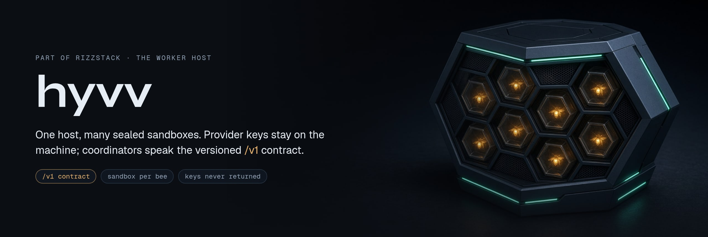
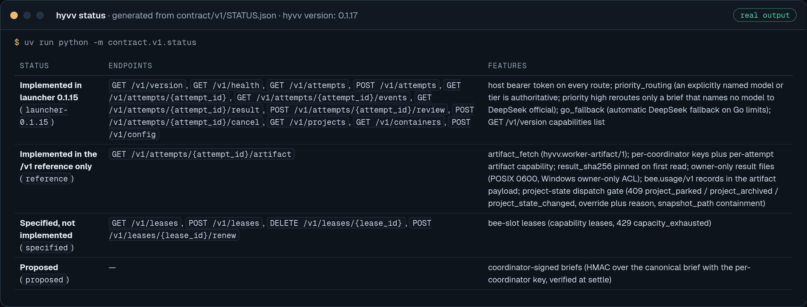
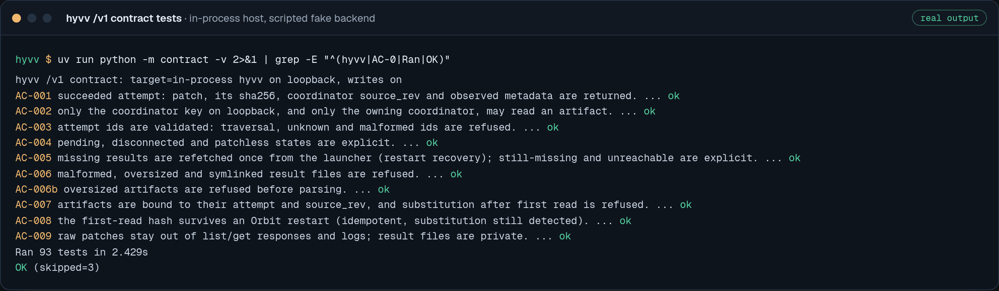

<p align="center"></p>

# hyvv

Worker-host runtime for local agent sandboxes. A hyvv process runs on a PC or SSH host, owns the sandboxes, holds provider keys without ever returning them, and exposes a narrow token-scoped HTTP API on loopback or a Tailscale address only.

**hyvv is a vocabulary, not a dependency on bundlebees.** The bee-themed names (hyvv, bees, beekeeper) are a shared language. Orbit, bundlebees, or any other coordinator can drive a hyvv host by speaking the versioned `/v1` contract.

## How the pieces fit

```
workflow (the method)  -->  bundlebees (orchestration)
Orbit (control surface) -->  bundlebees
bundlebees / any coordinator  -- /v1 contract -->  hyvv (this repo, one host)
hyvv --> sandboxes, usage ledger, optional Phoenix
```

This repository is the fourth layer: the runtime on each machine where work happens. It is not part of Orbit or bundlebees, so a host can be installed on its own.

## Status

The imported runtime is **v0.1.15**. This branch bumps the package to **v0.1.19** so a deployed build can be told apart; the release is still 0.1.15. A brief that names no model uses the host's configured `model`; a host can opt in to `zoo:glm-5.3-flash` with `"prefer_zoo": true` in `config.json` when it has a `zoo` key (off by default since 2026-11-19: the free pass refuses programmatic use and ends ~Nov 29), and Zoo's fallback is Nous DeepSeek v4.1 Flash 1017 (`nous:deepseek-v4.1-flash-1017`). Named models keep the 0.1.15 routing and are authoritative: unprefixed and `go:` go to OpenCode Go, `deepseek:` to the official DeepSeek API, and an explicitly named model always wins over `priority: high` (owner decision 2026-11-15: whatever the brief names is what runs). `priority: high` reroutes only a brief that names no model.

The `/v1` contract in `contract/v1` is the source of truth going forward:

- OpenAPI plus JSON Schemas for attempts, artifacts (`hyvv.worker-artifact/1`), errors, and usage records (`bee.usage/v1`)
- `GET /v1/version` returns `api_version` (`v1`, the contract version), `version` (the build actually running, e.g. `0.1.19+25.g7f73b7c`), `release` (the tag base: `0.1.19` on this branch, `0.1.15` released) and `build` (describe output, commit, commits past the tag, dirty flag, and where the identity came from), plus the capabilities this host supports (`priority_routing`, `go_fallback`). `artifact_fetch` and `leases` are advertised only once those routes ship
- Semver: `/v1` only ever gets additive changes. A breaking change is `/v2`, served alongside `/v1` for one release
- Conformance tests, including artifact acceptance criteria `AC-001`–`AC-010`

**Build identity.** A running launcher reports the commit it was built from, never the tag it merely sits near. `version` is `git describe --tags --always --dirty` mapped to `0.1.19` only for a clean checkout exactly at the tag, else `0.1.19+<commits>.g<sha>` with `.dirty` appended for a modified tree (`0.1.19+g<sha>` when no tag is reachable). The same identity is on `GET /v1/health` (`build`), the `Server` header, `launcher.py doctor`, `data_dir/runtime_status.json` and every attempt manifest. An installed copy has no `.git`, so run `python scripts/bake_build_info.py --out <install dir>` at package time to write `hyvv-build.json` beside `launcher.py`; an apply-update may instead record `describe` in `hyvv-deployed.json`. With only a SHA the version names the SHA (`0.1.19+g7f73b7c`), and with no identity at all it says `0.1.19+unknown` — never the bare tag.

The project-state dispatch gate from workflow `docs/18-parking-projects.md` is implemented in the `/v1` reference only, not in launcher 0.1.15. `POST /v1/attempts` with a `project` reads that project's `.workflow/project-state.json` and refuses parked or archived projects (409 `project_parked` / `project_archived`), unless an override flag plus a reason is given. The override is persisted and attributed to the authenticated caller. It also requires `project_state_generation` (409 `project_state_changed`), fails closed on invalid files, and checks `snapshot_path` containment. See [`contract/v1/README.md`](contract/v1/README.md#project-state-dispatch-gate-reference-only).

Nothing below the first row ships in the launcher yet. `GET /v1/attempts/{attempt_id}/artifact` is implemented and tested only in the `/v1` reference (`contract/v1/reference.py`); `/v1/leases` is specified but unimplemented; the project-state gate (parking) is reference-only. Coordinators should not read raw result files or runtime paths; they should use the artifact endpoint once the launcher ships it.

<!-- status:begin (generated from contract/v1/STATUS.json; python -m contract.v1.status --write) -->
| Status | Endpoints | Features |
| --- | --- | --- |
| **Implemented in launcher 0.1.19** (`launcher-0.1.19`) | `GET /v1/version`, `GET /v1/health`, `GET /v1/attempts`, `POST /v1/attempts`, `GET /v1/attempts/{attempt_id}`, `GET /v1/attempts/{attempt_id}/events`, `GET /v1/attempts/{attempt_id}/result`, `POST /v1/attempts/{attempt_id}/review`, `POST /v1/attempts/{attempt_id}/cancel`, `GET /v1/projects`, `GET /v1/containers`, `POST /v1/config`, `POST /v1/route`, `GET /v1/provision/capabilities`, `GET /v1/landing/events`, `GET /v1/capacity` | host bearer token on every route; priority_routing (an explicitly named model or tier is authoritative; priority high reroutes only a brief that names no model to DeepSeek official); go_fallback (automatic DeepSeek fallback on Go limits); GET /v1/version capabilities list |
| **Implemented in the /v1 reference only** (`reference`) | `GET /v1/attempts/{attempt_id}/artifact` | artifact_fetch (hyvv.worker-artifact/1); per-coordinator keys plus per-attempt artifact capability; result_sha256 pinned on first read; owner-only result files (POSIX 0600, Windows owner-only ACL); bee.usage/v1 records in the artifact payload; project-state dispatch gate (409 project_parked / project_archived / project_state_changed, override plus reason, snapshot_path containment) |
| **Specified, not implemented** (`specified`) | `GET /v1/leases`, `POST /v1/leases`, `DELETE /v1/leases/{lease_id}`, `POST /v1/leases/{lease_id}/renew` | bee-slot leases (capability leases, 429 capacity_exhausted); bee.usage/v2 records (open provider labels) |
| **Proposed** (`proposed`) | — | coordinator-signed briefs (HMAC over the canonical brief with the per-coordinator key, verified at settle) |
<!-- status:end -->



*`uv run python -m contract.v1.status` on this branch, rendered (captured Nov 18 2026).*

The generated table covers the attempt, artifact and lease contract. The provisioning and landing-export routes are additive, are documented below, and are not yet listed in `contract/v1/STATUS.json` because they are merged on `main` but not in a released build.

The optional [Rails worker recorder and read-only replication API](docs/rails.md) are available in this working tree. Recording and export are disabled by default; the replication reader has a separate credential from launcher control.

## Worker provisioning and landing export (merged on main; not released)

Scoped coding attempts also require a verified per-attempt Git workspace and
recorded seed. Setup or patch-collection errors produce failed attempts instead
of successful empty patches. See [workspace readiness and patch evidence](docs/worker-workspace-evidence.md)
for the failure contract and commissioning checks.

The merged `main` branch adds the launcher-owned operation a coordinator needs before it can dispatch a bee into a repository the host has never seen: create the workspace, check out the exact commit, verify it, and register it as an authorized project without a restart and without the coordinator touching the host filesystem. PR #5 (merged at `fe606b237bb9d447223ca943aeedb899ef527d29`) contains the provisioning work from PR #4 plus canonical landing-event export; PR #4 was closed as superseded. It is governed by a host-enrolled policy, not by the request. The design is recorded in [`docs/adr/0001-worker-provisioning.md`](docs/adr/0001-worker-provisioning.md).

**What works** (171 unit tests and 93 contract tests on 2026-11-14; deterministic, no live host):


*A real run of the provisioning and landing-export suites (no network, no live host), filtered to the refusal and recovery cases.*

- `GET /v1/provision/capabilities` — advertises `rizzstack.provisioning/1`, `enabled`, profiles, whether cleanup and receipt lookup are supported, mirrored repositories, and the idempotency rule. A disabled host advertises `enabled: false`; it never pretends.
- `POST /v1/provision/project` — declarative request: `repo` (`owner/name`), full 40-hex `source_rev`, `profile`, `job_id`, `project`, `idempotency_key`. The host derives the path from the profile's `workspace_root` plus a validated name.
- `GET /v1/provision/receipts/<idempotency_key>` — read-only receipt lookup that revalidates the live registry, the workspace path and the checkout; a stale receipt is refused (`receipt_stale`), not returned as truth.
- `POST /v1/provision/cleanup` — bounded deletion, only inside the profile root, only when the profile allows it and no attempt is running.

**Policy, not request, is authority.** The host enrolls `provisioning-policy.json` next to `config.json`:

```json
{"schema": "rizzstack.provisioning/1",
 "profiles": {"smoke": {"repo_patterns": ["mojomast/rizzstack-smoke"],
   "workspace_root": "/srv/orbit-worker-fixtures",
   "max_provisioned": 5, "ttl_hours": 24, "allow_cleanup": true,
   "git_actions": ["clone", "fetch", "checkout"],
   "task_scopes": ["smoke/answer.py"]}}}
```

A profile may also map a canonical repository to an enrolled mirror (`mirrors`), so an accepted ref is fetched from the governed mirror rather than GitHub; a request can never name a URL. The trusted-remote check compares the resolved transport URL while the repository identity stays canonical.

**Invariants enforced by the implementation:** no request-selected paths or reparse points; the only child process is `git` with a fixed argument vector; credentials stay in the host's git credential helper and are scrubbed from errors; `HEAD == source_rev`, the remote matches the repository identity and the worktree is clean before registration; `config.json` is rewritten atomically and the running registry updated; one journal record per idempotency key with an `O_EXCL` per-key lock; a `preparing` record with an existing workspace is re-verified and adopted, never re-cloned; cleanup leaves the journal record as evidence.

**What is experimental:** the live Windows host has not run this branch; the mirror and cross-machine transport are exercised against local fixtures, not a second machine. Provisioning is a one-time privileged host step: install this build and enroll a policy deliberately.

**Deployment status:** the endpoints are merged on `main` but do not exist on the running released launcher. Bundlebees pins the reviewed provisioning revision `8ffaf73000974e0ba273c72fca42e07b79c38106` and sets `REQUIRE_HYVV=1` in CI. Deploying the merged build, enrolling `provisioning-policy.json`, and performing the real-TTY authorization remain separate operator actions; the real-bee canary is **NOT RUN**.

**Canonical landing export.** `GET /v1/landing/events?after=<position>&limit=<n>` is an authenticated, read-only view of the durable outbox. It exports the stored canonical CloudEvents, never a reconstruction from attempt summaries. The cursor is a durable monotonic integer export position independent of the canonical event ID, so an event appended later is returned even when its ID sorts lower. Each row carries `cursor`, `event_id`, the canonical-content `sha256`, `file_sha256` for the exact stored bytes, and `event`; the page carries `next_cursor`, `has_more`, `retention` and the `rizzstack.bee-landed-export/1` schema. Invalid, expired and incompatible cursors return HTTP 400 with an explicit error code; unknown cursors are never a successful empty page. The bundlebees client recovers a legacy hash cursor once from the durable beginning under idempotent local ingestion and then persists the integer position. Cursor persistence occurs only after durable local ingestion, and exporter restart/crash recovery scans the outbox for unindexed files.

If an I/O error prevents reading the outbox or updating its index, landing export returns HTTP 503 (`landing_storage_unavailable`) without a page or cursor. An unreadable or inconsistent index (for example, duplicate positions) is preserved for diagnosis; repair it before retrying. Retry with the last consumed cursor once storage is available.

**Protocol pinning.** A backend must advertise `rizzstack.provisioning/1`; a `404`, or a different schema, is incompatible and dispatch stops. There is no legacy fallback. The receipt carries `status: ready`, `repo`, `resolved_revision`, `project`, `profile`, `host`, `verified` (`head`, `detached`, `clean`) and `transport`; the coordinator checks each field against the authorization and binds the job to the receipt digest. `5xx` means `ProvisionUncertain` — reconcile, never re-POST; `409` is a conflict.

**Enabling it.** `provisioning.enabled` defaults to `false`. Add the block to `config.json` and restart the launcher once:

```json
{"provisioning": {"enabled": true,
                  "policy": "provisioning-policy.json",
                  "journal": "provisioning"}}
```

## Install

hyvv is a Python package installed with **uv**. Signed releases (checksums, Sigstore, GitHub provenance, PyPI trusted publishing) are produced from tags by `.github/workflows/release.yml`. It runs as the logged-in user by default; a system service is opt-in.

```bash
uv tool install hyvv
# or, from a checkout:
uv sync
uv run hyvv version
```

Windows is first. From a checkout:

```powershell
.\scripts\install.ps1                 # copy into %USERPROFILE%\hyvv
.\scripts\install.ps1 -Prefix D:\hyvv
.\scripts\install.ps1 -Update         # wait until the host is idle, then swap
```

`-Update` replaces the old version-specific idle-swap waiters: it waits for zero running or queued attempts, copies the new `launcher.py`, health-checks, and rolls back on failure. It never overwrites `config.json`, `*.token`, or `*.key`, and it never prints those values.

**Deployment receipt.** When the admin apply-update records what it deployed in `hyvv-deployed.json` (beside the launcher's `config.json`, else in the data dir, else in the launcher's install directory -- the folder holding the running `launcher.py`, where the PC apply-update writes it; `deployment_receipt_path` in `config.json` names another file, with no fallback), `GET /v1/health` republishes only its validated identity as `deployment_receipt: {"deployed_at", "version", "rev", "describe"}` (`applied_at`/`installed_at_utc` and `revision`/`source_rev`/`sha`/`commit` are accepted spellings, and `version` may be describe-derived, e.g. `0.1.19+25.g7f73b7c`). It is re-read on every health call, needs no restart, and is never repaired: a missing configured file, an oversize file or a receipt without a zoned timestamp and a well-formed identity is shown as `{"status": "invalid", "reason": ...}`. Coordinators such as the bundlebees doctor use it as deployment evidence; a version string alone is not. With no `.git` and no `hyvv-build.json`, the launcher's own reported build falls back to this receipt's `describe`/`rev` (naming the commit, never the tag).

Then edit `%USERPROFILE%\.orbit-launcher\config.json` (seeded from `config.example.json` on a first install), run `.\scripts\new-token.ps1`, and `.\scripts\start.ps1`. The data directory name `.orbit-launcher` is kept so existing hosts keep working.

`config.example.json` binds `127.0.0.1`. To accept coordinators on a tailnet, set `bind` to the host's Tailscale address. Binding `0.0.0.0` is refused.

On Linux and macOS, `./scripts/install.sh [--dry-run] [--mode user|system] [--prefix DIR] [--version VER]` installs into a versioned uv venv as the logged-in user (`--mode system` copies files only in 0.1.15; service units come later).

Releases keep PyPI and GitHub assets apart: `uv build` writes only the sdist and wheel to `dist/` (published to PyPI), and `scripts/build_release_assets.py` writes `install.sh`, `install.ps1` and `checksums.txt` to `release-assets/`, which `release.yml` signs and uploads to the GitHub Release. CI runs the same build on every PR without tagging; `tests/test_release_metadata.py` checks that pyproject, the runtime version and the installer examples agree.

Provider keys belong in the environment or in a user-only file, never in the repo or in `config.json`:

| Route | Environment | Default file under the data dir |
| --- | --- | --- |
| OpenCode Go | `ORBIT_WORKER_GO_KEY` | `go.key` |
| Official DeepSeek | `DEEPSEEK_API_KEY` | `deepseek.key` |
| Zoo gateway (GLM 5.3 Flash) | `ORBIT_WORKER_ZOO_KEY` | `zoo.key` |

A `zoo` spec is sent to the sandbox as `OPENAI_API_KEY`, exactly like `go` and `deepseek`; `zoo_key_file` overrides the default path. See [Zoo routing](#zoo-routing-free-glm-53-flash) for the model id and its limits.

The API token is created by `scripts/new-token.ps1` and is not printed.

## Zoo routing (free GLM 5.3 Flash)

`zoo:glm-5.3-flash` sends `zoo/glm-5.3-flash` to `https://www.zoocode.dev/api/gateway/v1` over the
OpenAI-compatible wire, authenticated with the `zoo` key. The id matters: `zai/glm-5.3-flash` is the
paid model. With `"prefer_zoo": true` it is the default for a bee brief that names no model (opt-in; off by
default); the `simple` tier (`pool:free`) and any explicitly named model or tier are
untouched. A brief that names no model and is `priority: high` goes to DeepSeek official - except
when the host default is the free pool, which is picked before priority is considered. When rate limits persist or the pass ends, the spec falls back to
`nous:deepseek-v4.1-flash-1017` (Nous Portal, not Go's metered quota). A host without a readable `zoo`
key, or a host without `"prefer_zoo": true`, keeps its configured default model.
A `models` entry in `config.json` overrides or extends the built-in spec (for example a shorter
`backoff_s`).

Free-pass facts baked into the spec and worth knowing when tuning:

- Thinking is always on and spends the output budget first, so callers must allow at least **4096**
  output tokens (**8192** for coding); anything below 1024 is raised to 1024 by the gateway. Truncated
  reasoning shows up as an empty answer, not as an error.
- 16 concurrent runs are clean and 20 is the edge; the launcher's `MAX_WORKERS` ceiling of 10 keeps a
  host under it, so no extra Zoo-specific limiter is needed.
- A 429 carries `Retry-After` (5-7s) and the launcher waits that long instead of its fixed schedule;
  a 402 "Insufficient credits" is really an admission error and is retried on the same model.
- Streaming usage is always zero, so per-attempt metrics come from non-stream usage or an estimate.

## Contract

See [`contract/v1/README.md`](contract/v1/README.md) and [`contract/v1/SEMVER.md`](contract/v1/SEMVER.md).

### Run the contract tests (one command)

```bash
uv run python -m contract            # or: scripts/contract-test.sh  /  scripts/contract-test.ps1
```

By default this starts an in-process hyvv (`launcher.py` with its scripted fake backend, no sandboxes or keys) on a free loopback port and runs every test in `contract/v1/tests`: the schema checks, the artifact acceptance criteria `AC-001`–`AC-009` against `reference.py`, and the HTTP conformance suite `test_http_v1.py` for the implemented `/v1` endpoints (auth, health, projects, containers, attempt listing against `schemas/attempt.json`, rejected writes, and a create → events → result → review lifecycle).



*`uv run python -m contract -v` against the in-process host, filtered to the artifact acceptance criteria and the summary (captured Nov 18 2026).*

To check a running host instead, give its base URL and a token file:

```bash
HYVV_BASE_URL=http://127.0.0.1:47821 HYVV_TOKEN_FILE=path/to/orbit-api.token uv run python -m contract
# or: uv run python -m contract --base-url URL --token-file PATH
```

Live runs are read-only: they never create, review or cancel attempts, and the only POSTs are requests the host must reject (400/403/404). Add `--writes` (or `HYVV_CONTRACT_WRITES=1`) to also create one small attempt. The URL and token are never printed.

Orbit and bundlebees should pin this tree at a tag and run the same command in their CI against the in-process host or a mock.

## Development

```bash
uv run python -m unittest discover -s tests -v   # 171 tests, 2 skipped (2026-11-14)
uv run python -m contract -v                     # 93 tests, 3 skipped
```

The provisioning tests are part of the unit suite: `tests/test_provisioning.py`, `tests/test_provisioning_api.py` and `tests/test_provisioning_convergence.py` cover policy denial, path containment, checkout mismatch, idempotency, quota, crash adoption, cleanup and mirror transport. They need no network and no live host.

The Cua SDK contract test (`tests/test_sdk_contract.py`) is skipped when `cua` is not installed. Run it with `uv run --python 3.12 --with cua==0.5.0 python -m unittest tests.test_sdk_contract -v`.

## License

MIT. This matches [bundlebees](https://github.com/mojomast/bundlebees), [hermes-agent](https://github.com/mojomast/hermes-agent), and [comfyrizz](https://github.com/mojomast/comfyrizz). Some other mojomast repositories use a different license or do not yet have a `LICENSE` file.


A specified (not implemented) `/v1/leases` API makes hyvv the shared dispatch point for the global bee-slot cap (default 12, CI limited to 2). See [`contract/v1/LEASES.md`](contract/v1/LEASES.md). It is specified here and is not implemented in v0.1.15.
